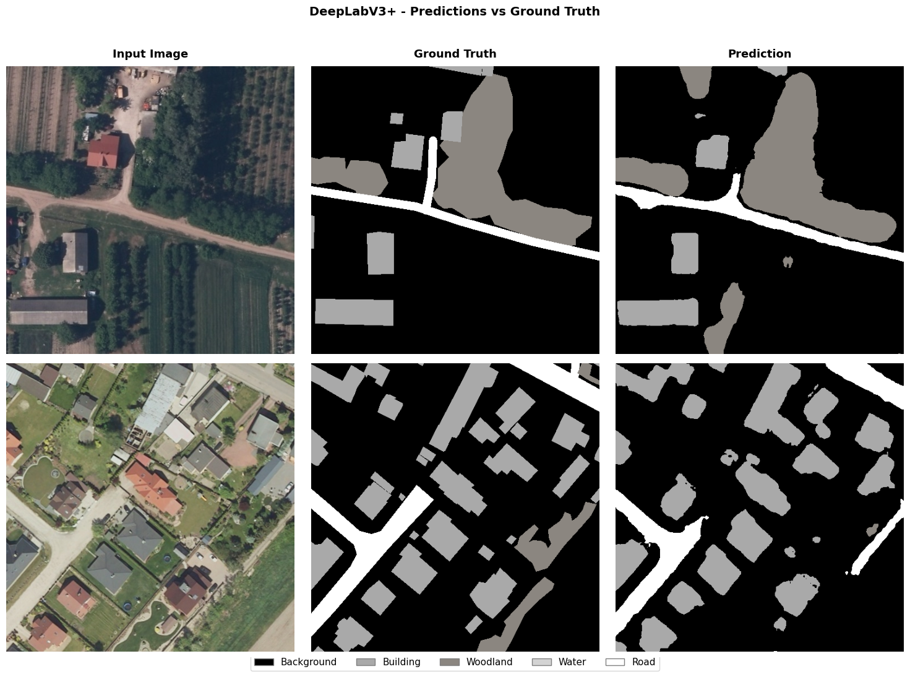
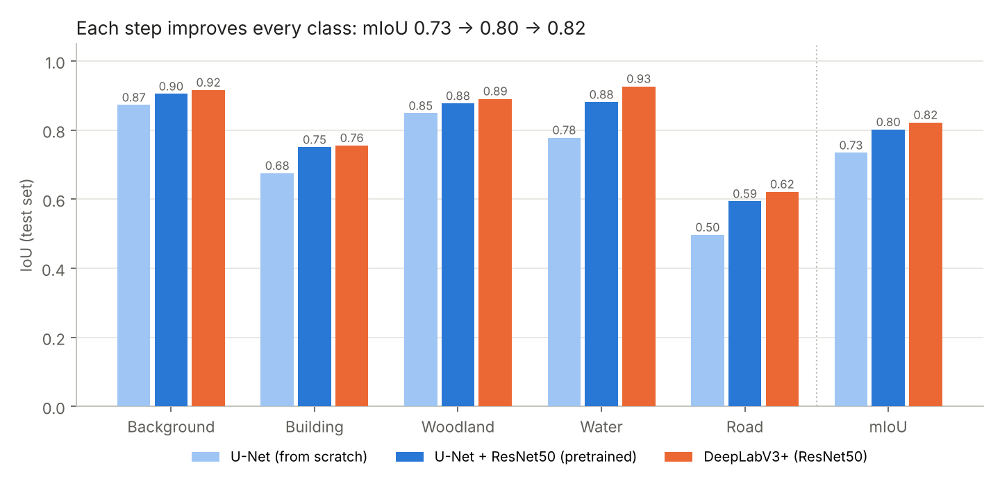
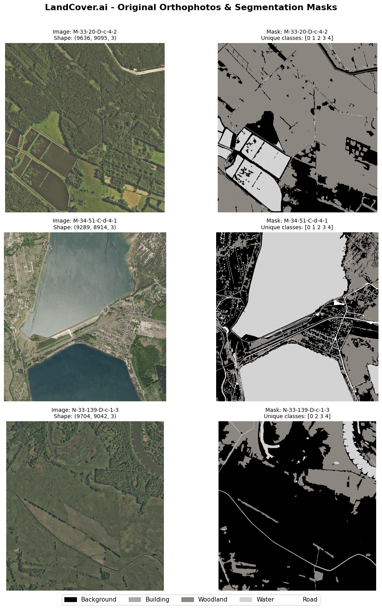
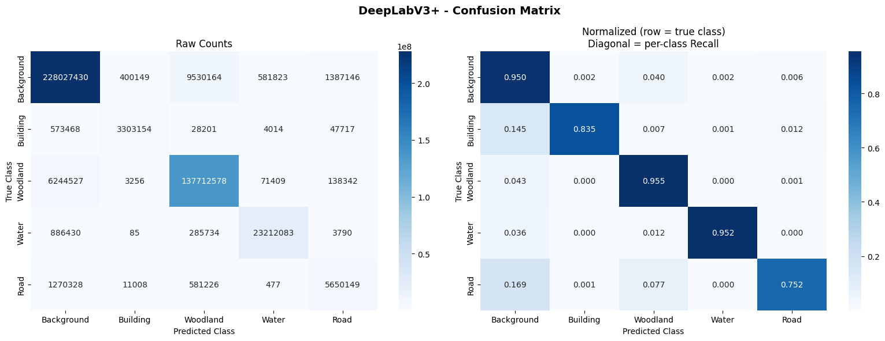
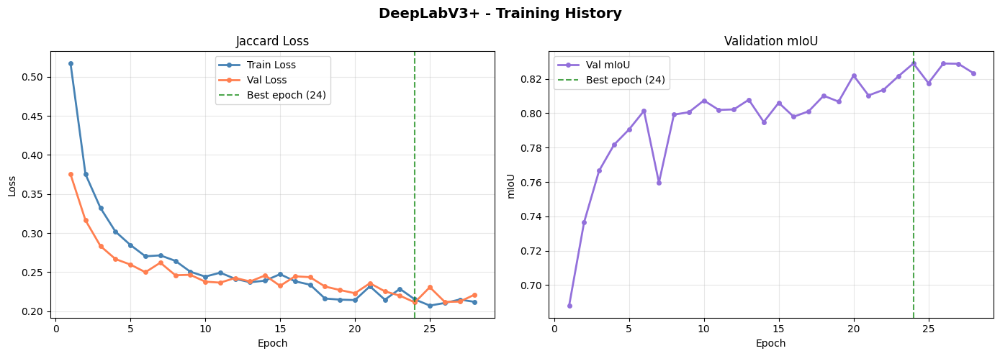

# Semantic Segmentation of Aerial Imagery

Deep Learning project at the **University of Pavia** (MSc Data Science, Year I, Semester II, Erasmus+ exchange). 

**Task:** classify every pixel of a high-resolution aerial photo as background, building, woodland, water or road. This kind of land-cover mapping is used in urban planning, environmental monitoring, agriculture and disaster response.

*Input tile, ground truth and DeepLabV3+ prediction.*

## Data

[LandCover.ai](https://arxiv.org/abs/2005.02264) is a set of 41 aerial orthophotos of rural Poland covering 216 km², at 25–50 cm per pixel, each about 9000×9500 px. We cut them into **10,674 tiles of 512×512 px** using the official train / val / test split.

The classes are **heavily imbalanced**: buildings are 0.9% of pixels and roads 1.6%, while background is 58%.

## Approach

We compared three architectures, each step adding one idea:

| # | Model | What changes | Parameters |
|---|---|---|---|
| 1 | **U-Net**, implemented from scratch | Baseline: encoder–decoder with skip connections, trained from random weights | 31.0M |
| 2 | **U-Net + ResNet50** | Transfer learning: encoder pretrained on ImageNet | 32.5M |
| 3 | **DeepLabV3+ (ResNet50)** | Multi-scale context with Atrous Spatial Pyramid Pooling (ASPP) | 26.7M |

**Training setup (same for all three):**
- **Jaccard (IoU) loss** instead of cross-entropy, so that rare classes count as much as background
- Adam optimizer with learning rate 5e-5, early stopping with patience 4, up to 30 epochs
- Data augmentation on the training set only. Because of the GPU budget, we trained on 60% of the training tiles (4,482).
- PyTorch with `segmentation-models-pytorch`, multi-GPU training with `DataParallel` on 2× NVIDIA T4
- Evaluation on the full held-out test set (1,602 tiles) with per-class IoU, mIoU and confusion matrices

## Results

| Model | mIoU | Building | Road | Water |
|---|---|---|---|---|
| U-Net (from scratch) | 0.734 | 0.675 | 0.497 | 0.778 |
| U-Net + ResNet50 | 0.802 | 0.751 | 0.594 | 0.881 |
| **DeepLabV3+** | **0.822** | **0.756** | **0.622** | **0.927** |

- **Transfer learning gives the biggest jump:** +6.7 mIoU points. The rare classes gain the most: roads +9.7 and buildings +7.5. The pretrained model also trained about 4.5× faster: 79 minutes vs. 358 minutes.
- **ASPP helps with multi-scale objects.** DeepLabV3+ adds the largest gain on water (+4.6), a class that ranges from small ponds to whole lakes.
- **Roads remain the hardest class.** They are thin and often mistaken for background or woodland.

More figures: dataset, confusion matrix, training curves

## Authors

[Laura-Vanesa Lungu](https://github.com/LVanesa) and [Filip-Luca Fuciuc](https://github.com/filiplucafuciuc), University of Pavia
